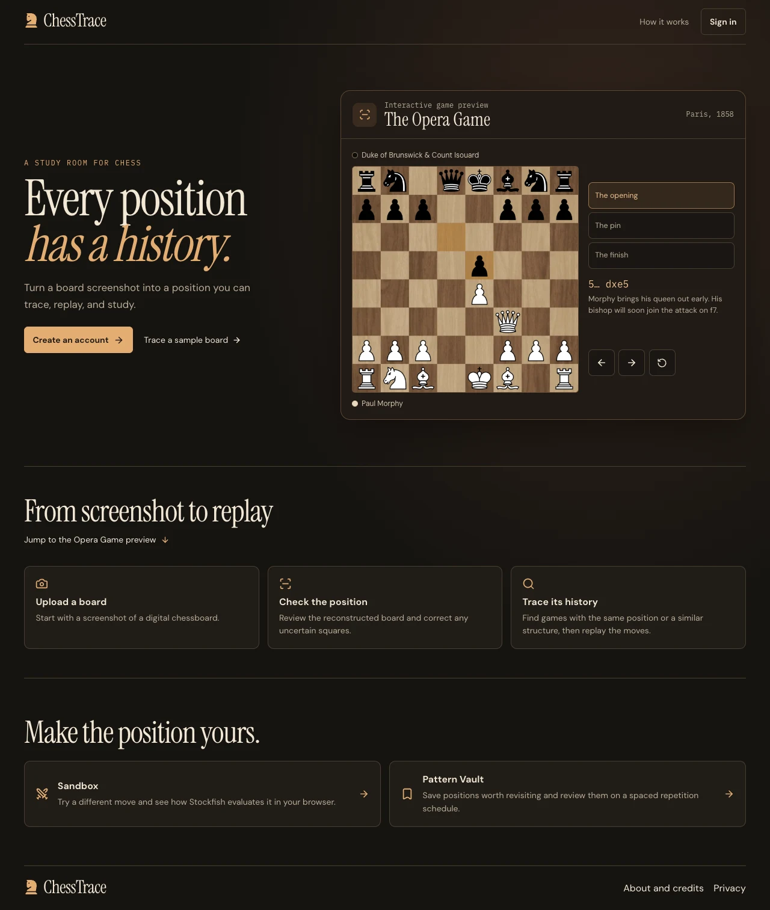
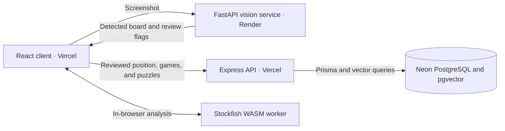

# ChessTrace

ChessTrace is a chess study app that connects a position on your screen to games you can replay. Upload a board screenshot, correct the detected pieces and game state, then search for the same position or a structurally similar one. Open a match at the relevant move to see how the game continued.

[Open ChessTrace](https://chesstrace.vercel.app) · [Sprint status](docs/STATUS.md)



[Mobile landing capture](docs/m8/screenshots/390-landing.webp) · [Guided sample capture](docs/m8/screenshots/390-guided-sample.webp)

## What you can do

- **Origin Lens** reconstructs a board from a screenshot and flags squares that need review. You can correct pieces, orientation, side to move, and castling rights before searching.
- **Sandbox** lets you play legal moves from a FEN, analyze the position with Stockfish, and find similar positions. Filter results by opening or decade and replay a matched game from its matching move.
- **Turning Points** accepts a Lichess game link, a completed Chess.com game, or pasted PGN. It analyzes the moves in a browser worker and surfaces up to three of the largest evaluation drops as puzzles.
- **Twin Game** compares your opening with the corpus and replays the closest match from the shared position.
- **Pattern Vault** saves puzzles with motif tags. Play moves, use hints, and review with an overridable SM-2 rating. The Vault charts move-based and self-rated solve rates.

## Stack and architecture

| Layer | Technologies | Role |
| --- | --- | --- |
| [Client](client-ui/) | React, Vite, Tailwind CSS, Chessground, chess.js, Stockfish WASM | Board review, replay, study tools, and local engine analysis |
| [API](api-server/) | Node.js, Express, Prisma, JWT, bcrypt | Authentication, game import, position search, and puzzle review |
| Database | Neon PostgreSQL, pgvector | Game PGNs, position vectors, accounts, and saved puzzles |
| [Vision service](vision-engine/) | Python, FastAPI, OpenCV, NumPy, python-chess, optional Tesseract OCR | Board detection, per-square sprite matching, orientation, and provisional FEN |



Exact search looks up the first three FEN fields: piece placement, side to move, and castling rights. Similarity search compares 32-dimensional structural vectors using L2 distance and an HNSW index. Stored PGNs and half-move numbers let the client replay each match in context.

## Corpus and hosting

The read-only corpus report on **November 17, 2026** measured **777 broadcast games**, **34,822 distinct compact positions**, and **33,037 vector-indexed positions** on the connected Neon database. The active storage profile retains a limited set of replay links per position. See the [corpus sources and licenses](data/SOURCES.md).

| Service | Free-tier allowance used by ChessTrace |
| --- | --- |
| Neon Free database | “1 GB of storage per project” and “100 CU-hours of compute per project per month.” [Neon Free](https://neon.com/blog/neon-free-plan-1-gb-per-project) |
| Vercel Hobby client and API | “4 hours included” of active CPU, “360 GB-hrs included” of provisioned memory, and “1 million included” function invocations per month. [Vercel Functions pricing](https://vercel.com/docs/functions/usage-and-pricing) |
| Render Free image scanner | “750 Free instance hours to each workspace per calendar month.” A service spins down after “15 minutes without receiving any inbound traffic.” The scanner can take time to respond on the first upload. [Render limits](https://render.com/docs/free) |

## Run locally

Use Node.js 22.12 or newer, Python with virtual environment support, and a PostgreSQL database with pgvector enabled. Run each service in its own terminal from the repository root.

1. **API.** In `api-server/`, copy `.env.example` to `.env`. Set `DATABASE_URL`, `DIRECT_URL`, and `JWT_SECRET`. For Neon, use a pooled URL for `DATABASE_URL` and a direct URL for `DIRECT_URL`. Set `CORS_ORIGIN` to the client origin, normally `http://localhost:5173`.

   ```sh
   cd api-server
   npm ci
   npx prisma generate
   npx prisma migrate deploy
   npm start
   ```

   The migration command above assumes a fresh database or one already managed by this project's migration history. For an existing database with a different history, see the [migration guide](docs/MIGRATIONS.md). A fresh database needs [game data](docs/DATA.md) before search can return matches.

2. **Vision service.** The service uses port 8000 and allows `http://localhost:5173` by default. Set `ALLOWED_ORIGINS` if the client runs elsewhere. Tesseract is optional for coordinate-label recognition.

   ```sh
   cd vision-engine
   python -m venv .venv
   source .venv/bin/activate
   python -m pip install -r requirements.txt
   python -m uvicorn app.main:app --port 8000
   ```

3. **Client.** The defaults point to the local API on port 5001 and vision service on port 8000. Set `VITE_API_BASE_URL` and `VITE_VISION_ENGINE_URL` in `client-ui/.env.local` if using different URLs.

   ```sh
   cd client-ui
   npm ci
   npm run dev
   ```

   Open the URL printed by Vite. Hosting configuration for [Render](render.yaml) and [Vercel](client-ui/vercel.json) is included.

## Verification and measured results

| Area | Result |
| --- | --- |
| Search benchmark | On a temporary Neon corpus of 1,000 games and 79,855 positions, PostgreSQL execution p95 was **0.500 ms exact** and **0.449 ms approximate** across 1,000 lookups. These timings exclude the network and API. |
| Board recognition | After adding Cases support, the detector recovered **15 of 15 exact piece placements** on the same supplied screenshot batch that exposed the missing piece set. [Scope and before/after results](docs/m8/vision-real.md). |
| Landing and Settings | See the [M8 Lighthouse results](docs/m8/README.md) for the current local build and test scope. |

Run `npm test` in `api-server/`, `npm run build` in `client-ui/`, and `python tests/test_pipeline.py` plus `python tests/test_detect.py` in `vision-engine/`.

See the [benchmark methodology](docs/BENCHMARKS.md), [vision evaluation](docs/VISION_EVAL.md), [UI screenshots](docs/ui/README.md), and [project status](docs/STATUS.md) for more detail.
